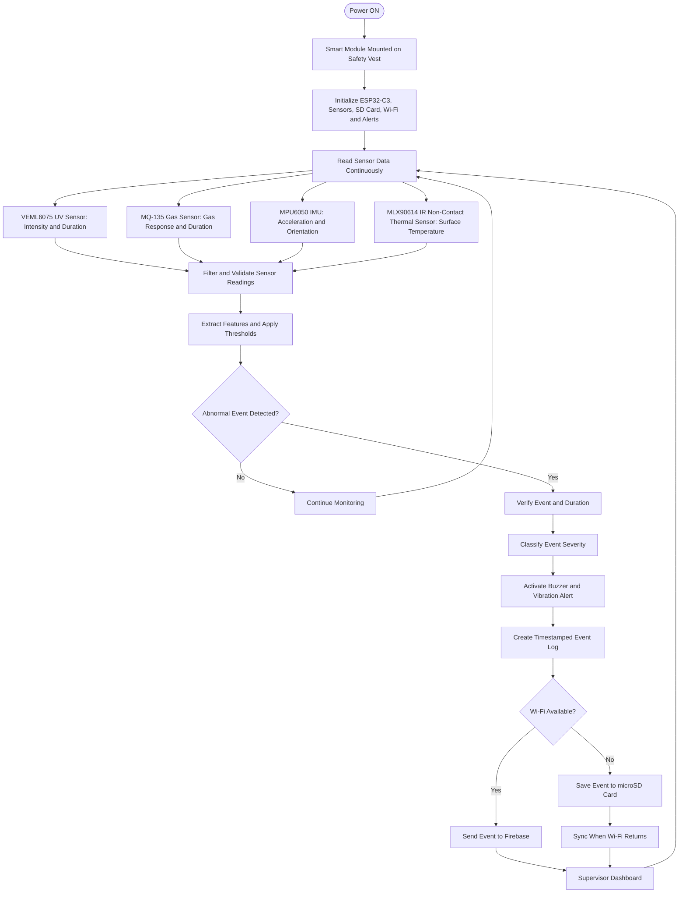

# SoniX — Smart Connected Safety Gear for  Welding Trades

**Smart India Hackathon 2026 | Problem Statement ID: 26243**


| Team | Team ID | PS Category | Theme |
|---|---|---|---|
| SONiX | 196996 | Hardware | Robotics and Drones |

An IoT-based worker safety monitoring system using ESP32-C3, environmental sensors, motion detection, non-contact thermal sensing, local alerts, and connected incident monitoring.

---

## 1. Project Overview

**SoniX** is a proposed smart safety gear system designed to improve worker safety in electrical maintenance, welding workshops, manufacturing environments, and vocational training laboratories.

Traditional Personal Protective Equipment (PPE), such as safety helmets, gloves, footwear, and protective clothing, provides physical protection but generally does not monitor environmental conditions or automatically report safety-related events.

SoniX supplements conventional PPE with a sensor-based monitoring module that collects environmental and motion data, evaluates configurable hazard conditions, alerts workers, and records potential safety incidents.

The proposed system uses an ESP32-C3 controller to process sensor measurements and supports planned wireless monitoring through a web dashboard.

> **Safety disclaimer:** SoniX is a supplementary monitoring prototype. It does not replace certified PPE, electrical isolation procedures, gas detectors, workplace safety standards, or trained supervision.

## 2. Problem Statement

Electrical maintenance and welding activities expose workers to multiple hazards, including:

- Excessive heat and overheating surfaces.
- Harmful gases, fumes, and smoke.
- Ultraviolet radiation and welding arc exposure.
- Sudden impacts, unusual movement, and potential falls.
- Delayed communication of incidents to supervisors.

Conventional PPE provides essential protection but may not provide real-time environmental monitoring, automatic event recording, or connected incident reporting.

SoniX proposes an integrated monitoring system to identify selected abnormal conditions, provide local warnings, and generate structured data for safety reviews and training improvements.

## 3. Project Objectives

- Monitor selected environmental conditions continuously.
- Measure ultraviolet radiation indicators during welding-related activities.
- Monitor gas-sensor response for changes in air quality.
- Measure target surface temperature using a non-contact infrared sensor.
- Track worker movement and identify potential fall-like events.
- Generate local alerts for verified abnormal conditions.
- Record timestamped safety events.
- Support online data transmission and offline event storage.
- Provide structured safety information for trainers and supervisors.

## 4. Proposed Hardware Components

| Component | Purpose | Interface |
|---|---|---|
| ESP32-C3 | Main controller and event-processing unit | Digital, analog, I²C, Wi-Fi |
| VEML6075 | UV intensity monitoring | I²C |
| MQ-135 | Gas and air-quality response monitoring | Analog output, depending on module |
| MPU6050 | Acceleration and orientation measurement | I²C |
| MLX90614 | Non-contact infrared target-temperature measurement | I²C |
| Buzzer | Audible warning | Digital output through suitable driver |
| Vibration motor | Physical warning to the worker | Driver circuit |
| MicroSD module | Local event storage, if integrated | SPI |
| Battery and power circuitry | Portable power supply | Board-specific |

**Hardware note:** Confirm the exact module versions, pin assignments, supply requirements, libraries, and interface compatibility before assembling the system.

## 5. System Architecture

The proposed system follows this processing pipeline:

**Sense → Validate → Calibrate → Filter → Extract Features → Evaluate Hazard Rules → Verify Event → Generate Alert → Log Event → Upload or Store Offline → Dashboard**

### Working sequence

1. **Power ON:** The safety module is switched on.
2. **Initialization:** The ESP32-C3 initializes the configured sensors, storage, network, and alert hardware.
3. **Sensor acquisition:** The controller reads UV, gas-response, motion, and thermal measurements.
4. **Validation:** Invalid, unavailable, or out-of-range readings are identified.
5. **Filtering:** Measurements are processed to reduce noise and transient fluctuations.
6. **Feature extraction:** The firmware calculates quantities such as acceleration magnitude, temperature changes, and threshold duration.
7. **Hazard evaluation:** The measurements are compared with configured thresholds.
8. **Event verification:** Persistence or confirmation rules help reduce false alarms.
9. **Local alert:** A buzzer and vibration motor provide warnings when installed.
10. **Event logging:** The system records relevant measurements and event information.
11. **Connectivity check:** If Wi-Fi is available, the event can be sent to the configured server.
12. **Offline handling:** If connectivity is unavailable, the event can be saved locally and synchronized later when implemented.

## 6. System Flowchart

The following Mermaid flowchart represents the proposed SoniX system.



## 7. Sensor Descriptions and Mathematical Models

The equations below are proposed processing models. Thresholds and calibration coefficients must be established experimentally before the measurements are used for safety decisions.

### 7.1 VEML6075 — UV Sensor

**Purpose:** Monitor UV-related readings and determine how long a configured threshold is exceeded.

Threshold detection:

```text
A_U[k] = 1, if U[k] > U_th
A_U[k] = 0, otherwise
```

Duration above threshold:

```text
T_U = sum(A_U[k] * delta_t)
```

Where:

- `U[k]` = UV reading at sample `k`.
- `U_th` = configured UV threshold.
- `A_U[k]` = threshold indicator.
- `delta_t` = sampling interval.
- `T_U` = accumulated time above the threshold.

The sensor output, units, and calibration must be verified before interpreting readings as exposure measurements.

### 7.2 MQ-135 — Gas Sensor

**Purpose:** Identify changes in gas-sensor response relative to a baseline.

Percentage change from baseline:

```text
Delta_G_percent = ((G[k] - G_base) / abs(G_base)) * 100
```

Where:

- `G[k]` = current sensor response.
- `G_base` = baseline response.
- `Delta_G_percent` = relative percentage change.

This equation measures relative response change, not gas concentration in parts per million (ppm).

The MQ-135 responds to multiple gases and environmental factors. Reliable gas-specific concentration estimates require appropriate calibration and validation.

### 7.3 MPU6050 — Motion Sensor

**Purpose:** Measure worker movement, acceleration, and orientation changes to identify potential fall-like events.

Acceleration magnitude:

```text
a_mag = sqrt(ax^2 + ay^2 + az^2)
```

Where `ax`, `ay`, and `az` are the acceleration readings along the three axes.

Example orientation-change calculation:

```text
Delta_theta = sqrt(
    (theta[k] - theta[k-1])^2
    + (phi[k] - phi[k-1])^2
)
```

Where:

- `theta` = one orientation angle.
- `phi` = another orientation angle.
- `Delta_theta` = orientation change between samples.

Angle differences must account for wraparound. Potential fall detection should combine acceleration, orientation, and subsequent movement information rather than relying on a single acceleration spike.

### 7.4 MLX90614 — Non-Contact Infrared Thermal Sensor

**Purpose:** Measure the temperature of a target without physical contact, such as a selected surface that may be overheating.

Temperature threshold detection:

```text
A_T[k] = 1, if T[k] > T_th
A_T[k] = 0, otherwise
```

Where:

- `T[k]` = measured target temperature.
- `T_th` = configured temperature threshold.
- `A_T[k]` = temperature-event indicator.

**Working principle:**

1. The sensor detects infrared radiation emitted by the target.
2. Its thermopile sensing element converts the received radiation into an electrical signal.
3. Internal electronics process the signal and provide a temperature reading.
4. The ESP32-C3 reads the measurement through the I²C interface.
5. Firmware compares the reading with a configured threshold.
6. A persistent abnormal reading can be evaluated by the event-verification logic.
7. A verified event can activate local alerts and be recorded for monitoring.

**Important limitations:**

- The sensor measures the target within its field of view, not necessarily the surrounding air temperature.
- A target-temperature reading is not automatically a worker body-temperature reading.
- Sensor positioning, target distance, field of view, emissivity, and environmental conditions affect measurements.
- Thresholds must be validated for the intended target and operating environment.

### 7.5 Optional PPE-Wear Monitoring

A suitable sensor may be used to indicate whether a specified PPE-wearing condition is detected.

```text
P[k] = 1, if wearing condition is detected
P[k] = 0, otherwise
```

The specific implementation depends on the selected sensor. This indicator alone does not prove that PPE is being worn correctly.

### 7.6 Event Verification

A simple persistence model is:

```text
A_event = 1, if condition persists for T_req
A_event = 0, otherwise
```

Where:

- `T_req` = minimum configured persistence duration.
- `A_event` = verified-event indicator.

Different hazard categories may require different thresholds and confirmation rules.

### 7.7 Sensor Calibration

For a sensor whose response has been verified as approximately linear over the required range:

```text
x = a * ADC + b
```

Where:

- `ADC` = raw analog-to-digital converter reading.
- `a` = calibration slope.
- `b` = calibration offset.
- `x` = calibrated measurement.

This model should only be used when the sensor's response supports a linear approximation. Other sensors may require nonlinear calibration.

## 8. Calibration and Validation

Before using sensor outputs for hazard decisions:

1. Confirm the sensor model and consult its datasheet.
2. Verify supply voltage, interface, and wiring.
3. Collect readings under known reference conditions.
4. Determine the calibration function and units.
5. Evaluate repeatability, drift, noise, and response time.
6. Establish configurable thresholds through controlled tests.
7. Test event persistence, recovery, and invalid-sensor handling.
8. Document test conditions, results, and limitations.

### Acceptance checklist

- [ ] Sensors initialize and communicate correctly.
- [ ] Measurement ranges and units are documented.
- [ ] Readings are repeatable under reference conditions.
- [ ] Disconnected or invalid sensors are reported appropriately.
- [ ] Event detection and recovery have been tested.
- [ ] False alarms and missed events have been evaluated.
- [ ] Local alerts work with the actual hardware.
- [ ] Offline logging and synchronization have been tested.

## 9. Firmware Decision Logic

The proposed firmware sequence is:

1. Initialize the controller and enabled sensor drivers.
2. Acquire sensor readings at configured intervals.
3. Validate measurement ranges and sensor status.
4. Apply calibration and filtering.
5. Calculate derived features.
6. Evaluate configurable hazard rules.
7. Apply persistence and confirmation logic.
8. Assign an event type and application-defined severity.
9. Activate available local alert hardware.
10. Store the event and associated measurements.
11. Attempt transmission when connectivity is available.
12. Retain unsent events for later synchronization.

Invalid measurements must be marked unavailable or erroneous rather than silently treated as normal readings.

## 10. Event Data and Logging

A proposed event record can contain the following fields:

| Field | Description |
|---|---|
| `timestamp` | Event time, if a reliable time source is available |
| `sensor_id` | Identifier of the reporting sensor |
| `event_type` | Potential hazard or sensor anomaly |
| `raw_value` | Original sensor reading |
| `calibrated_value` | Calibrated measurement, if available |
| `unit` | Measurement unit |
| `threshold` | Active configured threshold |
| `duration_ms` | Duration of the condition, if measured |
| `severity` | Application-defined event classification |
| `sensor_status` | Valid, unavailable, or error |
| `sync_status` | Pending, uploaded, or upload failed |

Actual sensor measurements must be distinguished from synthetic or example test data.

## 11. Proposed Technology Stack

| Category | Technology |
|---|---|
| Embedded controller | ESP32-C3 |
| Programming language | C/C++ |
| Development environment | Arduino IDE or PlatformIO |
| Motion sensing | MPU6050 |
| Gas-response monitoring | MQ-135 |
| UV monitoring | VEML6075 |
| Non-contact thermal monitoring | MLX90614 |
| Local storage | MicroSD, if integrated |
| Wireless communication | Wi-Fi, if implemented |
| Cloud data service | Firebase, planned |
| Dashboard | Web-based supervisor dashboard, planned |
| Validation | Datasheets, calibration records, and controlled tests |

The proposed components are not confirmation that every feature has been implemented or tested.

## 12. Repository Structure

```text
SoniX-Smart-Connected-Safety-Gear/
│
├── firmware/
│   ├── include/
│   │   ├── config.h
│   │   └── sensor_types.h
│   └── src/
│       ├── main.cpp
│       ├── sensors.cpp
│       ├── sensors.h
│       ├── formulas.cpp
│       └── formulas.h
│
├── docs/
│   ├── sensor-descriptions-and-formulas.md
│   ├── calibration.md
│   ├── system-flow.md
│   └── hardware-gap-checklist.md
│
├── config/
│   └── thresholds.example.json
│
├── data/
│   └── sample_events.csv
│
├── tests/
│   └── formula_test_vectors.md
│
├── README.md
└── LICENSE
```

## 13. Getting Started

### Prerequisites

- A compatible development computer.
- An ESP32-C3 development board.
- Confirmed sensor modules and their datasheets.
- Appropriate power supply and interface components.
- Arduino IDE or PlatformIO.
- Serial monitor for debugging.
- Optional MicroSD module and dashboard endpoint.

### Initial setup

1. Confirm the exact controller and board configuration.
2. Install the development environment.
3. Verify basic controller operation using serial output.
4. Connect and test each sensor independently.
5. Confirm sensor addresses, pins, interface types, and output units.
6. Implement and test calibration functions.
7. Enable hazard rules only after verifying their inputs.
8. Test event logging and alert outputs.
9. Integrate wireless communication and the dashboard.
10. Perform controlled system-level tests and document results.

A successful firmware compilation does not establish that the complete safety system is operational.

## 14. GitHub Setup

Create a repository named:

`SoniX-Smart-Connected-Safety-Gear`

Suggested description:

`IoT-based smart safety gear using ESP32-C3, UV, gas, motion, and non-contact thermal sensors for worker safety monitoring.`

To upload the project using Git:

```bash
git init
git add .
git commit -m "Initial SoniX safety gear repository"
git branch -M main
git remote add origin https://github.com/YOUR-USERNAME/SoniX-Smart-Connected-Safety-Gear.git
git push -u origin main
```


## Simulation 
[Open SONiX Simulation](https://velxio.dev/kholambedevansh/teamsonix/)
## 15. Feasibility and Risk Mitigation

| Challenge | Proposed mitigation |
|---|---|
| Unconfirmed sensor hardware | Confirm module versions and datasheets |
| Environmental interference | Use calibration, filtering, persistence checks, and field testing |
| Gas sensor lacks gas specificity | Select suitable gas-specific sensors for the intended hazards |
| UV readings lack validated exposure units | Confirm output units and calibration |
| Fall detection uncertainty | Combine motion features and validate representative movements |
| Temperature readings depend on target conditions | Validate sensor position, target, and operating conditions |
| Wireless failure | Retain local records and implement synchronization retries |
| Limited battery life | Measure actual power consumption and optimize sampling |
| Safety-critical misuse | Treat the prototype as supplementary monitoring |

## 16. Applications

Potential applications include:

- Electrical maintenance training laboratories.
- Welding training workshops.
- Industrial maintenance environments.
- Vocational training institutions.
- Worker-safety demonstrations and research prototypes.
- Safety-event logging for training and hazard analysis.

## 17. Current Prototype Scope

### Planned capabilities

- Sensor acquisition and calibration framework.
- UV, gas-response, temperature, and motion monitoring.
- Configurable threshold and persistence-based event logic.
- Potential fall-event detection.
- Optional PPE-wear monitoring.
- Event records for local storage.
- Wireless transmission and dashboard integration.

### Items to finalize

- Confirmed controller and sensor models.
- Pin assignments and sensor libraries.
- Calibration coefficients and validated measurement units.
- PPE-monitoring method and sensor placement.
- Alert hardware and power architecture.
- MicroSD integration and data-integrity testing.
- Dashboard API, authentication, and secure communication.
- Controlled testing and documented validation.

Move features into a **Demonstrated** section only after they are supported by hardware tests, firmware results, or reproducible simulation evidence.

## 18. Future Development

1. Finalize the hardware architecture and sensor interfaces.
2. Complete individual sensor drivers and calibration records.
3. Conduct controlled tests and quantify detection performance.
4. Improve enclosure design, cable routing, comfort, and battery life.
5. Review the design against relevant occupational safety requirements before real-world deployment.

## 19. Security and Data Protection

- Never commit Wi-Fi passwords, private keys, or Firebase service-account credentials.
- Use secure authentication and communication for dashboard integration.
- Restrict access to worker incident records.
- Avoid publishing personally identifiable worker data in sample datasets.
- Document the handling and retention of recorded safety data.

## 20. License

This repository uses the MIT License, subject to the terms in the included `LICENSE` file.

---

**TeamSoniX | SIH26243 |  K. K. Wagh Institute of Engineering Education & Research, Nashik **

*Connected monitoring to support safer electrical and welding work.*
