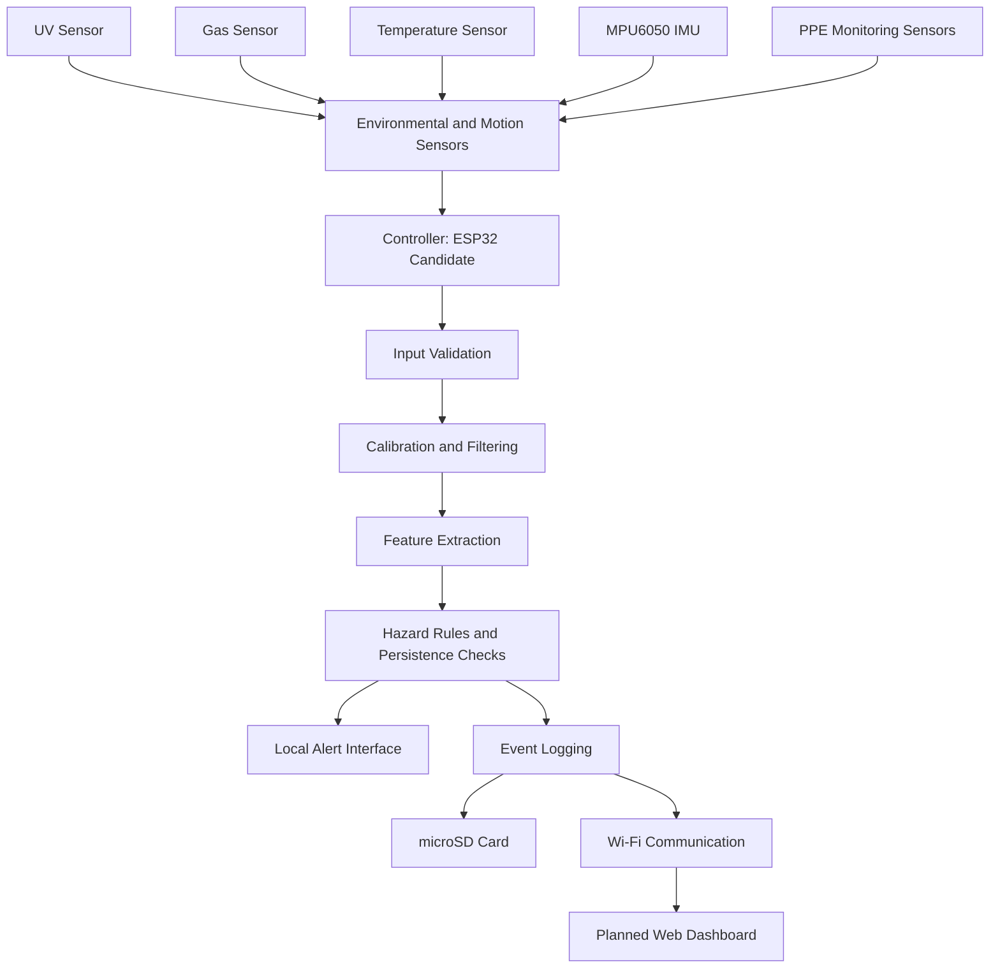

# sonix-smart-safety-gear
# Project Comprehensive Technical Report: SoniX (Smart Connected Safety Gear)

**Smart India Hackathon | Problem Statement ID:** 26243

---

##  1. Executive Summary & Project Description

**SoniX** is an IoT-enabled, retrofittable smart safety vest and module designed to protect workers in high-risk industrial environments such as electrical maintenance, manufacturing, and welding workshops. Traditional personal protective equipment (PPE) is entirely passive—it cannot provide early warnings, record near-misses, or instantly notify supervisors during emergencies.

SoniX solves this by integrating a multi-sensor hardware module into standard safety gear. It uses an **event-driven architecture**: sensors continuously monitor the environment, but the system filters out background noise and only logs and transmits **verified abnormal events** to a cloud dashboard (via Firebase) or a local MicroSD card (offline store-and-forward mode).

---

##  2. Core Processing Unit: ESP32-C3 Mini

The system is built around the **Espressif ESP32-C3** microcontroller module.

* **Architecture:** 32-bit RISC-V single-core microprocessor operating up to 160 MHz.
* **Connectivity:** Integrated 2.4 GHz Wi-Fi and Bluetooth 5 (LE), enabling real-time transmission of safety telemetry to supervisor dashboards.


* **Power Efficiency:** Designed for low power consumption, making it ideal for battery-powered wearable safety modules equipped with USB-C charging and power-management circuitry.


* **Interface Role:** Manages I2C and analog data acquisition from all onboard sensors, handles local logic execution, runs event verification filters, and controls local feedback actuators.


---

##  3. Detailed Sensor Breakdown & Implementation

The hardware suite utilizes robust, commercially available industrial sensors chosen for precision, low cost, and ease of retrofitting onto standard PPE vests or helmets.

### 1. InvenSense MPU-6050 (Tri-Axial Accelerometer & Gyroscope)

* **Purpose:** Worker fall detection, sudden impact tracking, and postural orientation monitoring.


* **Working Principle:** Combines a 3-axis accelerometer and a 3-axis gyroscope on a single silicon die using I2C communication.
* **Implementation & Mathematical Logic:**
* Computes the resultant acceleration ($A_{res}$) to prevent false triggers from normal physical exertion:


$$A_{res} = \sqrt{a_x^2 + a_y^2 + a_z^2}$$


* **Fall Verification Rule:** Triggers an emergency sequence only if $A_{res} \ge 2.5\,g$ (Impact Threshold) *followed* by a tilt orientation angle change of $>60^\circ$ relative to the vertical axis within a $500\,\text{ms}$ window.


### 2. Vishay VEML6075 (Ultraviolet / Arc Flash Sensor)

* **Purpose:** Detecting dangerous ultraviolet (UV) radiation and sudden electrical arc flashes common in welding and high-voltage electrical environments.


* **Working Principle:** Digital UV light sensor with I2C interface that measures UVA and UVB spectrum intensity and converts optical radiation into calibrated digital UV index data.
* **Implementation & Mathematical Logic:**
* **False Arc Mitigation:** Ambient workshop light or harmless sparks can cause optical spikes. SoniX applies a dual-condition filter:

$$\text{Intensity}(t) > \text{UV}_{\text{threshold}} \quad \text{AND} \quad \int_{t_0}^{t_1} \text{dt} \ge t_{\text{duration\_min}}$$


* Both intensity and time duration must be satisfied simultaneously before classifying the event as a dangerous arc exposure.


### 3. Hanwei MQ-135 (Air Quality & Toxic Gas/Fume Sensor)

* **Purpose:** Monitoring harmful gas leaks, toxic chemical fumes, and heavy smoke or welding gas accumulation.


* **Working Principle:** Metal oxide semiconductor (MOS) gas sensor whose conductivity changes proportionally when exposed to target gases like carbon monoxide, alcohol, benzene, and smoke.
* **Implementation & Mathematical Logic:**
* Uses an analog pin on the ESP32-C3 to read raw gas concentration levels.


* **Persistence Filter:** To prevent false alarms from transient gas puffs or wind shifts, a moving average window ($M_w$) evaluates persistence:

$$M_w = \frac{1}{N} \sum_{i=0}^{N-1} S_{raw}(t-i)$$


* If $M_w$ exceeds safe parts-per-million (PPM) thresholds for $k$ consecutive cycles, a gas hazard event is confirmed.


### 4. Melexis MLX90614 (Infrared Thermal / Hot-Surface Sensor)

* **Purpose:** Non-contact temperature measurement to detect hot surfaces, overheating electrical wiring, equipment failures, or abnormal worker body temperatures.


* **Working Principle:** Infrared thermometer for non-contact temperature measurements using a thermopile detector chip sensitive to infrared radiation emitted by objects, communicating via I2C.
* **Implementation:** Continuously monitors ambient and object temperatures; triggers a thermal alert if temperatures exceed industry safety limits (aligned with ACGIH guidelines).


---

##  4. Peripherals, Storage, & Data Pipeline
# SoniX — Smart Connected Safety Gear for Electrical and Welding Trades

**Smart India Hackathon 2026 | Connected Worker Safety | Embedded Systems and IoT**

## Project Overview

SoniX is a smart connected safety gear concept designed to improve worker safety in electrical maintenance and welding environments. It combines sensor-based monitoring, embedded processing, local alerts, and a planned web dashboard to help workers, trainers, and site supervisors identify potentially unsafe conditions.

Conventional personal protective equipment (PPE), such as helmets, gloves, safety footwear, and protective clothing, primarily provides physical protection. SoniX aims to supplement this protection with real-time environmental and motion monitoring.

The system focuses on identifying unusual environmental conditions, monitoring worker movement, detecting potential fall events, and recording safety-related data for later analysis.

> **Safety note:** SoniX is intended as a supplementary monitoring system. It does not replace certified PPE, workplace safety procedures, or appropriate protective equipment.

---

## Problem Statement

Electrical maintenance and welding expose workers to hazards such as excessive heat, harmful fumes, ultraviolet radiation, and falls. Conventional PPE helps protect workers but may not provide real-time information about changing environmental conditions or automatically record safety events.

SoniX proposes a connected safety system that monitors selected environmental and motion parameters, identifies configurable hazard conditions, records events, and communicates safety information to a dashboard.

The project aims to improve hazard awareness, support trainers and supervisors, and generate structured safety data that can assist with workplace safety reviews and training improvements.

---

## Solution Overview

The proposed system follows a modular architecture:

1. Sensors collect environmental and motion measurements.
2. The ESP32-class controller reads supported sensor outputs.
3. Calibration and filtering prepare readings for processing.
4. Feature extraction calculates useful values from raw measurements.
5. Configurable hazard rules identify potential unsafe conditions.
6. Local alert hardware can notify the worker when installed.
7. Event data can be stored on a microSD card.
8. A planned web dashboard can display sensor readings and event history.

**Core pipeline:**

`Sense → Validate → Calibrate → Filter → Extract Features → Evaluate Hazard Rules → Generate Alert → Log Event → Upload Data → Dashboard`

The exact controller, sensor modules, alert hardware, and communication protocol will be confirmed during implementation.

---

## Key Features

| Feature | Purpose |
|---|---|
| UV monitoring | Monitors ultraviolet sensor readings and exposure indicators |
| Gas and fume indication | Identifies changes in the response of the selected gas sensor |
| Temperature monitoring | Tracks temperature measurements from the selected sensor |
| Motion monitoring | Measures acceleration and angular movement |
| Fall-like event detection | Uses motion features to identify potential fall events |
| PPE monitoring | Intended to monitor selected PPE-wearing conditions using suitable sensors |
| Event logging | Records timestamped measurements and potential hazard events |
| Connected monitoring | Supports planned transmission of safety data to a web dashboard |
| Modular firmware | Allows sensor drivers and processing functions to be developed and tested independently |

Features should be described as operational only after their hardware and firmware have been implemented and tested.

---

## System Architecture



The diagram represents the proposed system architecture. Individual sensor branches depend on the final hardware configuration.

---

## Sensor Descriptions and Mathematical Models

### 1. UV Sensor

**Candidate module:** VEML6075.

A UV sensor measures ultraviolet radiation through its supported sensing channels. The output and calibration requirements depend on the selected module and its configuration.

Let \(U[k]\) represent a validated UV measurement at sample \(k\).

A configurable threshold indicator is:

\[
A[k]=
\begin{cases}
1,&U[k]>U_{\mathrm{th}}\\
0,&U[k]\le U_{\mathrm{th}}
\end{cases}
\]

The accumulated time above a configured threshold can be estimated as:

\[
T_{\mathrm{above}}=\sum_k A[k]\Delta t
\]

where \(\Delta t\) is the sampling interval.

If the sensor provides calibrated irradiance \(E[k]\) in \(\mathrm{W/m^2}\), radiant exposure can be estimated as:

\[
H=\sum_k E[k]\Delta t
\]

The unit of \(H\) is \(\mathrm{J/m^2}\).

Raw sensor counts or an uncalibrated UV index must not be treated as irradiance. Exposure calculations require appropriate calibrated measurements.

### 2. Gas and Fume Sensor

**Candidate module:** MQ-135.

The MQ-135 responds to changes in the surrounding gas composition. Its output can vary with temperature, humidity, sensor conditioning, and the gases present.

A baseline-relative response indicator is:

\[
\Delta G_{\%}=
\frac{G-G_{\mathrm{base}}}
{|G_{\mathrm{base}}|}\times100
\]

where:

- \(G\) is the current sensor response.
- \(G_{\mathrm{base}}\) is the established baseline.
- \(\Delta G_{\%}\) is the percentage change relative to that baseline.

This formula identifies relative changes; it does not directly calculate gas concentration in ppm.

The MQ-135 is not a selective detector for every hazardous welding emission. Specific gases may require dedicated sensors and gas-specific calibration.

### 3. Motion Sensor — MPU6050

The MPU6050 combines a three-axis accelerometer and a three-axis gyroscope. It provides motion measurements that can support movement analysis and potential fall detection.

The resultant acceleration magnitude is:

\[
a_{\mathrm{mag}}=
\sqrt{a_x^2+a_y^2+a_z^2}
\]

where \(a_x\), \(a_y\), and \(a_z\) are the acceleration components in consistent units.

A simple orientation-change feature is:

\[
\Delta\theta=
\sqrt{(\theta_t-\theta_{t-1})^2+
(\phi_t-\phi_{t-1})^2}
\]

where \(\theta\) and \(\phi\) represent orientation angles. Angle wrapping must be handled when calculating differences.

Fall-like detection can combine acceleration peaks, orientation changes, and a subsequent period of low movement. A single acceleration spike does not prove that a fall occurred.

### 4. Temperature Sensor

**Candidate module:** MLX90614.

The MLX90614 is an infrared temperature sensor. Its readings depend on the target, field of view, distance, emissivity, and surrounding conditions.

A configurable temperature indicator is:

\[
A_T=
\begin{cases}
1,&T>T_{\mathrm{th}}\\
0,&T\le T_{\mathrm{th}}
\end{cases}
\]

where \(T\) is the selected temperature measurement and \(T_{\mathrm{th}}\) is the configured threshold.

The system must distinguish between surface temperature, ambient temperature, and body temperature. An infrared surface reading should not automatically be interpreted as a medical body-temperature measurement.

### 5. PPE Monitoring

PPE monitoring can be implemented using suitable sensors selected for the specific item being monitored. The sensing approach may differ for a helmet, glove, or other protective equipment.

A basic binary indicator can represent the detected state:

\[
P[k]=
\begin{cases}
1,&\text{PPE condition detected}\\
0,&\text{PPE condition not detected}
\end{cases}
\]

The meaning of this state depends on the installed sensor and its placement. The indicator should not be used until the detection method has been tested under realistic working conditions.

---

## Calibration and Validation

Calibration is required before sensor outputs are interpreted as physical measurements or used for safety decisions.

### General calibration model

For a sensor with a verified linear response:

\[
x=a\cdot ADC+b
\]

where:

- \(ADC\) is the raw digital reading.
- \(a\) is the scale factor.
- \(b\) is the offset.
- \(x\) is the calibrated measurement.

This model should be used only when a linear relationship has been established. Nonlinear sensors may require a different calibration function.

### Proposed calibration workflow

1. Confirm the exact sensor module and its datasheet.
2. Verify the power supply, interface, and wiring.
3. Collect readings under known reference conditions.
4. Establish the calibration function and measurement units.
5. Evaluate repeatability, drift, noise, and response time.
6. Establish application-specific thresholds using appropriate references and controlled tests.
7. Test event detection, persistence, and recovery behavior.
8. Document test conditions, results, and limitations.

### Acceptance criteria

Each sensor should have documented evidence of:

- Correct initialization and communication.
- Valid measurement ranges and units.
- Repeatable response under reference conditions.
- Defined behavior for disconnected or invalid sensors.
- Verified event detection and recovery.
- Appropriate false-alarm and missed-event testing.

Thresholds should remain configurable and unvalidated until the relevant calibration and safety testing have been completed.

---

## Firmware Decision Logic

The proposed event-processing sequence is:

1. Initialize the controller and enabled sensor drivers.
2. Acquire sensor readings at configured intervals.
3. Validate measurement ranges and sensor status.
4. Apply calibration and filtering.
5. Calculate derived features, such as acceleration magnitude.
6. Compare supported measurements against configured rules.
7. Apply persistence or confirmation logic where appropriate.
8. Assign a candidate event type and severity.
9. Activate available local alert hardware.
10. Store the event and associated readings.
11. Attempt dashboard transmission when connectivity is available.
12. Retain unsent events for later synchronization.

Invalid measurements should be marked as unavailable rather than silently treated as normal readings.

---

## Event Data and Logging

A proposed event record may contain:

| Field | Description |
|---|---|
| `timestamp` | Event time, when a reliable time source is available |
| `sensor_id` | Identifier of the reporting sensor |
| `event_type` | Sensor anomaly or candidate hazard category |
| `raw_value` | Original sensor reading, where useful |
| `calibrated_value` | Calibrated measurement, if available |
| `unit` | Measurement unit |
| `threshold` | Active configured threshold |
| `duration_ms` | Duration of the detected condition, if measured |
| `severity` | Application-defined event classification |
| `sensor_status` | Valid, unavailable, or error |
| `sync_status` | Pending, uploaded, or upload failed |

Measured values, calculated features, and synthetic test data should be clearly distinguished.

---

## Technology Stack

| Category | Proposed Technology |
|---|---|
| Embedded controller | ESP32-class development board; exact model to be confirmed |
| Programming | C/C++ |
| Embedded development | Arduino IDE or PlatformIO |
| Motion sensing | MPU6050 candidate |
| Gas sensing | MQ-135 candidate |
| UV sensing | VEML6075 candidate |
| Temperature sensing | MLX90614 candidate |
| PPE monitoring | Sensor selection depends on the monitoring method |
| Data storage | microSD module, if integrated |
| Wireless communication | Wi-Fi, if supported and implemented |
| Dashboard | Web-based monitoring interface, planned |
| Testing | Datasheets, calibration records, sensor test logs, and controlled test procedures |

The listed modules are candidates from the preliminary design and are not confirmation that all hardware has been integrated or tested.

---

## Repository Structure

```text
SoniX-Smart-Connected-Safety-Gear/
│
├── firmware/
│   ├── include/
│   │   ├── config.h
│   │   └── sensor_types.h
│   └── src/
│       ├── main.cpp
│       ├── sensors.cpp
│       ├── sensors.h
│       ├── formulas.cpp
│       └── formulas.h
│
├── docs/
│   ├── sensor-descriptions-and-formulas.md
│   ├── calibration.md
│   ├── system-flow.md
│   └── hardware-gap-checklist.md
│
├── config/
│   └── thresholds.example.json
│
├── data/
│   └── sample_events.csv
│
├── tests/
│   └── formula_test_vectors.md
│
├── README.md
└── LICENSE
```

Adjust the directory and file names to match the actual repository.

---

## Getting Started

### Prerequisites

- Compatible development computer.
- Selected ESP32 development board.
- Datasheets for confirmed sensor modules.
- Appropriate power supply and interface components.
- Arduino IDE or PlatformIO.
- Serial monitor for debugging.
- Optional microSD module and dashboard endpoint.

### Initial Firmware Setup

1. Confirm the controller model and board configuration.
2. Install the selected development environment.
3. Verify basic controller operation using serial output.
4. Connect and test each sensor independently.
5. Confirm sensor addresses, pins, interface type, and output units.
6. Implement and test calibration functions.
7. Enable hazard rules only after verifying the associated inputs.
8. Test event logging and alert outputs.
9. Integrate wireless communication and the dashboard.
10. Perform controlled system-level tests and document the results.

A successful firmware compilation alone does not establish that the complete safety system is operational.

---

## Feasibility and Risk Mitigation

| Challenge | Mitigation |
|---|---|
| Unconfirmed sensor hardware | Finalize modules and document datasheets before enabling drivers |
| False alarms from environmental interference | Use calibration, filtering, persistence checks, and field testing |
| Gas sensor lacks gas specificity | Use suitable gas-specific sensors for the hazards being measured |
| UV readings lack calibrated units | Confirm sensor output and calibrate before calculating exposure |
| Fall detection uncertainty | Combine motion features and validate against representative movements |
| Temperature readings depend on target conditions | Verify the intended measurement type and operating conditions |
| Wireless connection failure | Retain local event records and retry synchronization |
| Limited battery life | Measure actual power consumption and optimize sampling and communication |
| Safety-critical misuse | Treat the system as supplementary monitoring, not as certified protection |

---

## Impact and Applications

Potential applications include:

- Electrical maintenance training laboratories.
- Welding training workshops.
- Industrial maintenance environments.
- Vocational training institutions.
- Worker-safety demonstrations and research prototypes.
- Safety-event logging for training and hazard analysis.

SoniX aims to improve awareness of selected environmental and motion-related hazards while generating structured data that can support safety reviews and future training improvements.

---

## Current Prototype Scope

### Planned Capabilities

- Sensor acquisition and calibration framework.
- Temperature, gas-response, UV, and motion monitoring.
- Configurable threshold and persistence-based event logic.
- Potential fall-event detection.
- PPE monitoring using suitable sensors.
- Event records for local storage.
- Wireless transmission and dashboard integration.

### Items to Finalize

- Final controller and board selection.
- Confirmation of sensor models and pin assignments.
- Calibration coefficients and validated measurement units.
- PPE monitoring method and sensor placement.
- Alert hardware and power architecture.
- microSD integration and data-integrity testing.
- Dashboard API, authentication, and secure communication.
- Controlled testing and documented validation.

Capabilities should be moved into a **Demonstrated** section only when supported by actual hardware tests, firmware results, or reproducible simulation evidence.

---

## Future Development

1. Finalize the hardware architecture and sensor interfaces.
2. Complete individual sensor drivers and calibration records.
3. Integrate and test local alerts and event storage.
4. Develop the dashboard for sensor status and event history.
5. Conduct controlled tests and quantify detection performance.
6. Improve enclosure design, cable routing, wearability, and battery life.
7. Review the design against relevant occupational safety requirements before real-world deployment.

---

## License

Add the appropriate open-source license file after selecting the license terms for the project.

---

**SoniX — Smart Connected Safety Gear for Electrical and Welding Trades**

*Connected monitoring to support safer electrical and welding work.*
* **Local Feedback Actuators:**
* **Piezo Buzzer & Vibration Motor:** Provide instant physical and acoustic warnings directly to the worker on the vest, ensuring they react immediately even in loud industrial settings.


* **Offline Storage (MicroSD Card Module):**
* Connected via SPI to the ESP32-C3.


* Implements an **Offline-First Store-and-Forward** mechanism. If Wi-Fi connectivity fails in remote parts of a workshop or site, all verified incident logs and timestamps are safely stored locally on the SD card and automatically synced to the Firebase cloud dashboard once connection is re-established.


* **Cloud Integration & Dashboard:**
* Leverages ESP32-C3 Wi-Fi to push structured JSON safety data packets to Firebase, powering a real-time web dashboard for supervisors to view live alerts, near-miss analytics, and compliance logs.
